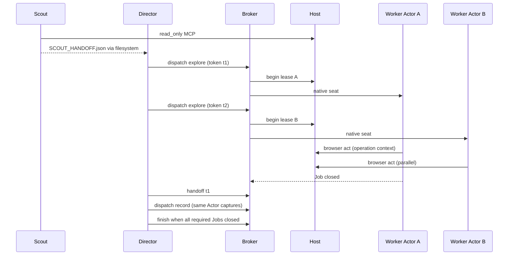

# Parallel director treatment (runner-only)

Composer candidate for private scout → director → bounded page workers with configurable concurrency (`1` vs `≤3`). No Core `beginExplorePass`, no UI execution UUID, no Product or Skill changes.

---

## Caller usage (spec)

### Launch scored arm (parent-owned organic request; concurrency is the only deliberate delta between serial and parallel trials)

```bash
# Serial comparison arm
node --import tsx scripts/explore-completion-693/coordination.mjs \
  SOURCE_FRESH_ROOT FRESH_OUTPUT director-parallel PRIVATE_LEDGER \
  --max-concurrent-workers 1

# Parallel comparison arm (same policy, higher cap)
node --import tsx scripts/explore-completion-693/coordination.mjs \
  SOURCE_FRESH_ROOT FRESH_OUTPUT director-parallel PRIVATE_LEDGER \
  --max-concurrent-workers 3
```

`runArm` accepts `parallelOptions: { maxConcurrentWorkers: 1 | 2 | 3, scoutMaxWallSeconds: 180, pageTaskMaxWallSeconds: 900, pageTaskMaxActions: 12 }` with defaults suitable for eval. Parent fixes organic request, Product, date, source, assets, and scoring; the runner only threads `maxConcurrentWorkers` into `coordinate`.

### Unscored overlap capability gate (must pass before any scored `director-parallel` launch)

```bash
node --import tsx scripts/explore-completion-693/proofs/overlap-capability.mjs \
  SOURCE_FRESH_ROOT PROOF_OUTPUT --workers 2 --actions-per-worker 3
```

Exits `0` only when two fixture workers on **different** Actors complete overlapping `act` + settle windows without cross-execution attribution errors in `events.jsonl`, both Jobs close, and Windows process-tree closure is confirmed for both seats.

### Director seat (unchanged surface; ACCESS text reflects concurrency cap)

```text
node director.mjs dispatch assignment.json   # up to maxConcurrentWorkers explore Jobs open
node director.mjs status                     # jobs + per-execution host slices + shared budget
node director.mjs handoff job.json           # after closed Job only
node director.mjs finish stop.json           # all required Jobs closed
```

### Scout seat (new role, same Luna/medium native contract)

Scout runs once at arm start via `coordinate` (not director-dispatch). It receives `SCOUT.md`, read-only Knowledge wrappers at workspace root, and **no** `browser.mjs` / `tools.mjs` write paths.

```text
node solo.mjs call read_setup
node solo.mjs call read_knowledge_catalog
# Optional: read_knowledge_context / read_explore for already-public remainder only
# Write SCOUT_HANDOFF.json (schema below) and exit; wall clock ≤ scoutMaxWallSeconds
```

Broker rejects scout tokens on `/browser`, `/call` record_*`, and `/coordination`.

### Page worker seat (unchanged wrappers per execution directory)

```text
node browser.mjs act ACTIONS.json    # single-element array; one intentional action
node tools.mjs call record_observation
# HANDOFF.md + exit; local completion ≠ whole-request completion
```

### Recording seat (unchanged authority)

```text
# ASSIGNMENT.json mode record, sourceExecution closed same-Actor explore execution
# import_evidence from issued captures only; no browser act
```

### Call site 1: broker dispatch idempotence (director)

```javascript
const job = await directorDispatch({ token: 'nav-emily-dashboard', mode: 'explore', actor: 'Emily.dawson',
  question: boundedPageQuestion({ goal: 'dashboard inventory', maxActions: 12, ... }),
  references: [scoutExecutionId], stateDeps: ['knowledge:surface:/dashboard'] });
const again = await directorDispatch({ token: 'nav-emily-dashboard', ...same });
assert.deepEqual(job, again); // same Job; no second native seat
```

### Call site 2: host begin with Actor lease

```javascript
// Supervisor POST /host begin — host picks execution id, binds Actor lease, never blocks other Actors
const execution = await post('/host', {
  command: 'begin', actor: 'michael.reed', assignment, recordOnly: false,
});
// execution.executionId, execution.actor, execution.workingDirectory, browser/tools paths
```

### Call site 3: parallel status for director polling

```javascript
const { jobs, budget, executions } = await directorStatus();
// jobs: { token, state, executionId, actor, result }
// executions: [{ executionId, actor, phase, inFlightApi, lastActionId, leaseHeld }]
// budget: shared remaining api + exploreSecondsRemaining (unchanged semantics)
```

---

## Core data shapes

```typescript
/** Trial-wide knobs; serial vs parallel differs only in maxConcurrentWorkers. */
type ParallelOptions = {
  maxConcurrentWorkers: 1 | 2 | 3;
  scoutMaxWallSeconds: number;       // default 180
  pageTaskMaxWallSeconds: number;    // default 900
  pageTaskMaxActions: number;        // default 12
};

type SeatRole = 'scout' | 'director' | 'worker' | 'record' | 'solo';

/** Immutable for one browser act + settle generation (fixes late-callback attribution). */
type OperationContext = {
  executionId: string;
  actor: string;
  actionId: number;           // global unique browser action number (retained)
  openedAt: string;
};

/** Per-Actor browser lease; at most one active execution per Actor. */
type ActorLease = {
  actor: string;
  executionId: string | null;
  page: PlaywrightPage;       // existing pages.get(actor)
  inFlightApi: number;
  lastNetworkActivity: number;
  latestCaptureRefs: CaptureRef[];
  quiet: { getInFlight: () => number; getLastActivity: () => number };
};

/** Per-execution session (replaces mutable globals activeExecution / activeBrowserAction). */
type ExecutionSession = {
  id: string;                 // eNNN
  actor: string;
  recordOnly: boolean;
  assignment: Assignment;
  workingDirectory: string;
  startedAt: string;
  releasedAt?: string;
  /** Active only during act/settle; null between actions. */
  operation: OperationContext | null;
  /** API requests attributed while this execution held the Actor lease (subset of global apiCount). */
  attributedDispatched: number;
};

type Assignment = {
  token: string;
  mode: 'explore' | 'record';
  actor: string;
  question: string;
  references: string[];       // closed execution ids
  sourceExecution?: string;
  /** Director-declared Product/Knowledge interference hints (advisory + logged). */
  stateDeps?: string[];
};

type ScoutHandoff = {
  kind: 'scout_handoff';
  elapsedSeconds: number;
  actors: { name: string; id: string }[];
  surfacesSeen: string[];     // public ids or paths from catalog/UI only
  suggestedPageTasks: Array<{
    actor: string;
    rationale: string;        // from rendered snapshot or public Knowledge title
    starterPath?: string;       // e.g. /dashboard from catalog, not invented
    stateDeps: string[];
  }>;
  limits: { scoutMaxWallSeconds: number };
  unfinished: string[];
};

type JobState = 'launching' | 'running' | 'closed' | 'failed' | 'not_started';

type Job = {
  token: string;
  assignment: Assignment;
  state: JobState;
  executionId?: string;
  actor?: string;
  done: Promise<Job>;
  result?: { closure; taskStop; stopReason; lastMessage };
};

type CaptureRegistryEntry = {
  sourcePath: string;
  sha256: string;
  actor: string;
  executionId: string;
  actionId: number;
  stage: 'immediate' | 'after';
  /** Present for failed act: broker still registers failure capture refs when host returns them. */
  failed?: boolean;
};

type HostControlState = {
  phase: 'preparation' | 'candidate' | 'inspection';
  apiCount: number;
  refused: number;
  actionCount: number;
  eventNumber: number;
  exploreFinished: boolean;
  candidateStartedAt: number | null;
  /** executionId -> session */
  sessions: Map<string, ExecutionSession>;
  /** actor -> lease */
  leases: Map<string, ActorLease>;
  /** Single-flight MCP writer (not global browser chain). */
  mcpChain: Promise<void>;
};
```

---

## Module map and signatures

| Module | Responsibility |
|--------|----------------|
| `coordination.mjs` | `openSession`, `coordinate` policy `director-parallel`, scout launch, director launch, `ParallelOptions`, overlap gate hook in ledger |
| `coordination-boundary.mjs` | `parseAssignment` (+ optional `stateDeps`), `Capabilities` (+ scout role), `Dispatches` concurrent cap |
| `parallel-dispatch.mjs` | `createDispatchPool({ maxConcurrentWorkers, dispatches, begin, launch, post })` |
| `scout-contract.mjs` | `validateScoutHandoff(json)`, `writeScoutPrompt(workspace, limits)` |
| `page-task.mjs` | `boundedPageQuestion(template)`, `enforcePageAssignment(assignment, options)` |
| `serve.mjs` | Host: leases, per-actor route handler, operation context, targeted `/force-release` |
| `host-lease.mjs` | `acquireActorLease(actor, executionId)`, `releaseExecution(executionId, reason)`, `owner(input)` |
| `host-operate.mjs` | `operate(input)` using lease + operation context only |
| `host-interceptor.mjs` | Per-context `route` with **frozen** `(executionId, actionId)` per in-flight fetch |
| `host-mcp.mjs` | `callMcpQueued(state, input)` serializes mutations, permits concurrent reads |
| `settle.mjs` | unchanged `awaitQuiet`; host passes per-actor getters |
| `coordinated-access.mjs` | ACCESS.md: concurrency cap, scout rules, failure capture note |
| `shutdown.mjs` | Stop admission, join scout+director+jobs, `drainAllLeases()`, fence, finalize |
| `proofs/interleave-deterministic.mjs` | Red/green delayed-callback attribution |
| `proofs/overlap-capability.mjs` | Unscored native overlap gate |
| `proofs/windows-job-closure.mjs` | Asserts owned server + seat trees `kind: 'closed'` |

### `Dispatches` (replace serial `active`)

```javascript
export class Dispatches {
  constructor(maxConcurrentWorkers) {
    this.jobs = new Map();
    this.running = new Set(); // tokens
    this.max = maxConcurrentWorkers;
    this.fenced = false;
  }
  start(token, launch) {
    if (this.jobs.has(token)) return this.jobs.get(token);
    assert.ok(!this.fenced);
    assert.ok(this.running.size < this.max, 'Concurrent worker cap reached');
    const job = launch();
    this.jobs.set(token, job);
    this.running.add(token);
    return job;
  }
  close(token, closure) {
    assert.ok(this.running.has(token));
    if (closure.kind !== 'closed') this.fenced = true;
    this.running.delete(token);
  }
  assertClosed() {
    assert.ok(this.running.size === 0 && !this.fenced);
  }
}
```

### `host-lease.mjs` (sketch)

```javascript
/** @returns {ExecutionSession} */
export function beginExecution(state, { actor, assignment, recordOnly }) {
  assert.ok(!state.leases.get(actor)?.executionId, `Actor ${actor} already leased`);
  const session = createSession(state, { actor, assignment, recordOnly });
  state.leases.get(actor).executionId = session.id;
  state.sessions.set(session.id, session);
  return session;
}

export function owner(state, input) {
  const session = state.sessions.get(input.executionId);
  if (!session || session.releasedAt) throw new Error('This worker has no active execution ownership');
  const lease = state.leases.get(session.actor);
  if (lease.executionId !== session.id) throw new Error('Actor lease does not match execution');
  return session;
}

export async function releaseExecution(state, executionId, meta) {
  const session = state.sessions.get(executionId);
  await drainActorQuiet(state, session.actor);
  session.releasedAt = new Date().toISOString();
  session.release = meta;
  state.leases.get(session.actor).executionId = null;
  session.operation = null;
}
```

### Targeted force-release

```javascript
// POST /force-release { executionId?, reason }
// If executionId omitted and exactly one lease held, release that (supervisor shutdown).
// Never clear all executions in one untargeted call during parallel work.
```

### Control plane concurrency (replace single `chain`)

```javascript
// Per-actor micro-queue: chains only browser + settle for that Actor's page.
// Global: apiCount++, eventNumber++, begin/release, finish-explore, fence.
// MCP: host-mcp.mjs appends to mcpChain only for record_* and import_evidence; reads may jump ahead with shared revision check.
```

### `coordinate` policy `director-parallel` (sketch)

```javascript
export async function coordinate(session, { policy, parallelOptions, ... }) {
  assert.equal(policy, 'director-parallel');
  const opts = { maxConcurrentWorkers: 1, scoutMaxWallSeconds: 180, ...parallelOptions };
  session.dispatches = new Dispatches(opts.maxConcurrentWorkers);

  const scoutExec = await beginScoutExecution(session); // read-only host path, no browser lease
  const scout = launch('scout', scoutWorkspace, scoutPrompt(opts));
  const scoutResult = await Promise.race([
    scout.done,
    timeout(opts.scoutMaxWallSeconds * 1000, 'scout wall exceeded'),
  ]);
  const handoff = validateScoutHandoff(readScoutOutput(scoutResult));

  const director = launch('director', manifest.workspace, directorPrompt(handoff, opts));
  // director uses dispatch pool; on finish, shutdown joins scout seat + all jobs + director
}
```

---

## Explicit invariants

1. **Shared budget.** One `apiCount`, one `candidateStartedAt`, one `exploreEndAt` / `endAt`. Worker-local completion never increments a separate allowance. Status `remaining` is always global.

2. **Actor lease.** At most one open `ExecutionSession` per Actor name. `maxConcurrentWorkers ≤ 3` and three contexts cap simultaneous page workers. Same-Actor parallel pages are out of scope.

3. **No global ownership pointers.** `activeExecution`, `currentActor`, and `activeBrowserAction` are removed from shared mutable host state. Interceptor and `log()` read `OperationContext` captured at request start and `ExecutionSession` keyed by `executionId`.

4. **Late and background API traffic.** When `route.fetch` starts, bind `{ executionId, actionId, actor }` from the lease's current `operation` or, if null, attribute to `lease.executionId` with `actionId: null` and `kind: 'background'` only if the request's auth token maps to that lease's Actor. Cross-Actor token mismatch logs `attribution_mismatch` and refuses. Delayed callbacks never read a global "current" pointer.

5. **Settle isolation.** `awaitQuiet` uses per-Actor `inFlightApi` / `lastNetworkActivity`. Final shutdown calls `drainAllLeases()` sequentially per Actor then a short global MCP drain.

6. **Director cannot act.** `Capabilities.authorize` unchanged: director `/browser` and record_* forbidden; invoking worker `browser.mjs` uses worker token without supervisor rights.

7. **Dispatch idempotence.** Same token + deep-equal assignment returns existing Job. Different assignment with same token throws. Conflicting relaunch fences `dispatches.fenced` and stops admission.

8. **Closure fencing.** Any required seat non-`closed` tree, unknown native identity, or `dispatches.fenced` blocks `finish-explore` and export. `shutdown` stops all seats, awaits Jobs, targeted releases, drain, then fence/finalize.

9. **Recording grace.** After `explorationClosed()`, explore `act` and new API admission denied; `record_*`, `import_evidence`, readbacks, snapshot/screenshot on **existing** captures allowed until recording deadline. No new Product state discovery mutations in grace (director dispatch of new explore Jobs rejected; record Jobs for closed sources still allowed).

10. **Capture provenance.** Broker registers capture refs on success **and** on browser error payloads (`captureRefs` in rejection). `import_evidence` checks sha256, path, same-context issuance, and accepted Observation ids. Actor/platform/unknown `productVersion` checks preserved.

11. **Scout bounds.** Scout seat has wall-clock cap only (no dispatch budget). Output must cite only `read_*` public Knowledge and prepared setup; no Product browser. Director may ignore suggestions not grounded in later handoff review.

12. **Page task bounds.** Assignment `question` embeds `pageTaskMaxActions` and `pageTaskMaxWallSeconds`; broker optionally rejects explore dispatch when director exceeds caps in assignment metadata envelope (director instructed, mechanical backstop logs violation).

13. **State dependencies.** `stateDeps` on assignments are logged and passed to workers; director serializes conflicting deps (same dep key) across concurrent Jobs even when Actors differ.

14. **Legacy policies.** `solo`, `continuation-approx`, `director-review` code paths unchanged when `policy !== 'director-parallel'`.

15. **Event sequence.** `eventNumber` remains globally monotonic; attribution fields carry `workerExecutionId`, `browserActionId`, `actor`.

---

## Bounded implementation plan

### Phase A — Host lease refactor (`serve.mjs` + `host-*.mjs`)

- Introduce `HostControlState` maps; migrate `owner` / `operate` / `begin` / `release` / `force-release`.
- Split global HTTP `chain` into per-Actor browser chains + `mcpChain`.
- Port interceptor to per-context closure with frozen attribution struct per fetch.
- Register failure `captureRefs` in broker (coordination forward path).

### Phase B — Concurrent `Dispatches` + targeted release

- Replace `Dispatches.active` with `running` set and cap.
- Change `dispatch` job completion to `post('/force-release', { executionId, reason })`.
- Update `coordinated-access.mjs` ACCESS text (remove "only one worker").

### Phase C — Scout + `director-parallel` policy

- `scout-contract.mjs`, scout capability rules, `coordinate` branch.
- `page-task.mjs` question templates from `ScoutHandoff`.
- `runArm` CLI flag `--max-concurrent-workers`.

### Phase D — Deterministic proofs (no Product scoring)

**Red (`proofs/interleave-deterministic.mjs`).** Fixture host with intentional global-pointer regression flag `PERQUIRO_PROOF_LEGACY_GLOBALS=1`. Two workers alternate `act` with injected `setTimeout` before `route.fetch` completes. Assert cross-execution `workerExecutionId` contamination in `events.jsonl`. Expect failure.

**Green.** Same script with lease refactor; assert each `product` event's `workerExecutionId` matches the worker that owned the action, including delayed completion after parallel `act`.

**Windows Job closure (`proofs/windows-job-closure.mjs`).** Use existing `owned-process.mjs` / `launchOwned` to spawn overlap proof seats; assert `closure.kind === 'closed'` and no orphaned `productPid`.

**Overlap capability (`proofs/overlap-capability.mjs`).** Real generated wrappers, two Luna/medium fixture seats (or fixture CLI if parent configures), different Actors, overlapping wall clock; gate ledger before scored arm.

### Phase E — Saving grace + shutdown drain

- Enforce explore vs recording routes in `Capabilities` and host phase checks.
- `shutdown`: `dispatches.assertClosed()` includes scout if still running; `drainAllLeases` before `/finish-explore`.

---

## Director workflow (concurrency-parameterized)



Serial arm: `maxConcurrentWorkers: 1` forces second `dispatch` to wait until first `close` frees the running set.

---

## Failure and stop behavior

| Event | Behavior |
|-------|----------|
| Required worker `exit !== 0` | `fenced`, stopping, arm `failed` |
| Budget/clock exhausted mid-Job | `AllowanceEnded`, Job `not_started` or worker budget stop; director `finish` with honest `unfinished` |
| Unknown native identity | Existing `waitForIdentity` rejection; fence |
| Browser act error with captures | Register failure refs; worker may still hand off; director compares saved bodies |
| Supervisor STOP file | Same as today; drain parallel leases before inspection |

---

## What this design deliberately does not do

- No Core/UI explore pass registration.
- No per-worker request counters or reset.
- No simultaneous pages on one Actor.
- No generic DAG scheduler or priority queue framework.
- No eval Product source changes or second MCP session per worker.
